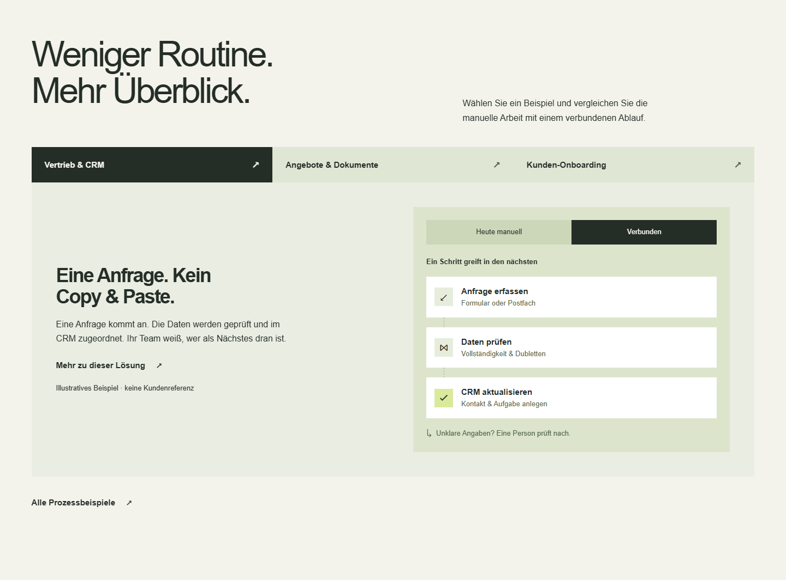

# Prozesswerk

**Responsive Unternehmenswebsite mit Anfrageverarbeitung und geschützter Lead-Verwaltung.**

Ein KI-unterstütztes Portfolio- und Praxisprojekt mit Next.js, React und TypeScript. Es verbindet eine eigenständige Gestaltung mit serverseitiger Formularverarbeitung, Datenbank, Tastaturbedienung und automatisierten Tests.


[Lokal starten](#lokal-starten) · [Prüfstand](#qualität-und-tests) · [Architektur](docs/ARCHITECTURE.md) · [Dokumentation](docs/README.md)

## Ziel und Funktionen

Die Website erklärt ein konzeptionelles Dienstleistungsangebot für kleine und mittelständische Unternehmen: Websites und Shopify-Shops sowie Prozessoptimierung und Automatisierung.

- Responsive Start-, Leistungs-, Beispiel-, Wissens- und Kontaktseiten mit zwei gegliederten Leistungsbereichen.
- Eigene Gestaltungskonzepte „Werkraum“ und „Alltag“ zum Öffnen im Browser; fiktive Marken, keine Kundenreferenzen.
- Prozessvergleich: drei Beispiele und jeweils „Heute manuell / Verbunden“.
- Tastaturbedienbares Menü, Fokusführung, Navigation ohne JavaScript und reduzierte Bewegung.
- Anfrageformular mit drei Pflichtfeldern, serverseitiger Validierung und erhaltenen Eingaben bei Fehlern, auch ohne JavaScript.
- PostgreSQL, geschützter Admin-Bereich, Statuspflege, Aktivitätsverlauf und abgesicherter CSV-Export.
- Transaktionale Outbox und Worker; optionale E-Mails und signierte Webhooks sind standardmäßig deaktiviert.
- Metadaten, strukturierte Daten und Open-Graph-Bild; Vorschau absichtlich nicht indexierbar.
- Statischer Portfolio-Export ohne Backend, mit deaktiviertem Formular.

Das Repository ist selbst kein Shopify-Shop und keine Shopify-Migrationssoftware. Die Dienstleistungen sind Website-Inhalt. Es gibt keine echte Bestellabwicklung oder behauptete Kundenprojekte.

<details>
<summary>Weitere aktuelle Screenshots</summary>

### Leistungen


### Prozessvergleich



### Kontakt auf dem Smartphone


</details>

## Technischer Aufbau

| Bereich      | Umsetzung                                                  |
| ------------ | ---------------------------------------------------------- |
| Anwendung    | Next.js 15 App Router, React 19, TypeScript Strict         |
| Gestaltung   | Eigenes CSS, lokale Bilder, Systemschriften, Next Image    |
| Eingaben     | Server Actions und Zod                                     |
| Datenhaltung | PostgreSQL und Prisma 6                                    |
| Zugriff      | scrypt, gehashte Sitzungen, geschützte Cookies             |
| Zustellung   | Outbox, Wiederholungen, optional Resend und HMAC-Webhooks  |
| Qualität     | ESLint, TypeScript, Node-Test-Runner, Playwright, axe-core |

Versionen stehen im [Lockfile](package-lock.json). Eine öffentliche Live-Demo ist noch nicht veröffentlicht. Screenshots und lokale Vorschau zeigen den aktuellen Stand.

## Lokal starten

Voraussetzungen: Node.js 22 oder 24 und npm. Für die reine Seitenvorschau wird keine Datenbank benötigt.

```sh
git clone https://github.com/mekanxy-art/prozesswerk.git
cd prozesswerk
npm ci
```

Alternativ GitHub → **Code → Download ZIP**, entpacken und den Projektordner im Terminal öffnen.

`.env.example` nach `.env` kopieren:

```powershell
Copy-Item .env.example .env
```

Unter macOS/Linux: `cp .env.example .env`.

Für die Vorschau `FORM_SECRET` und `RATE_LIMIT_SECRET` leer lassen, `DELIVERY_ENABLED=false` und `SITE_INDEXABLE=false` beibehalten.

```sh
npm run dev
```

[http://localhost:3000](http://localhost:3000) öffnen. Ohne Konfiguration bleibt das Anfrageformular sichtbar deaktiviert. Das ist der erwartete Vorschaumodus. Der Server ist zunächst bewusst nur lokal erreichbar.

### Anfrageverarbeitung aktivieren

Eine eigene lokale PostgreSQL-Datenbank anlegen, `DATABASE_URL` setzen und zwei unabhängige Secrets erzeugen. Diesen Befehl zweimal ausführen und die Ergebnisse als `FORM_SECRET` und `RATE_LIMIT_SECRET` ausschließlich lokal hinterlegen:

```sh
node -e "console.log(require('crypto').randomBytes(32).toString('hex'))"
```

Browseradresse, `APP_ORIGIN` und `SITE_URL` müssen exakt zusammenpassen. `localhost` und `127.0.0.1` sind unterschiedliche Ursprünge. Im Produktionsmodus werden schreibende Anfragen ohne gültige konfigurierte Herkunft abgewiesen.

```sh
npm run db:deploy
npm run dev
```

`DELIVERY_ENABLED=false` verhindert externe Zustellung, nicht die Speicherung. Für Tests ausschließlich künstliche Daten verwenden. [Admin-Anlage und Betrieb](docs/BETRIEB.md) · [Getrennte Datenbanktests](docs/DATABASE-SECURITY-TESTS.md).

### Produktionsfassung ansehen

```sh
npm run build
npm start
```

Docker-Dateien liegen bei; ein Docker-Lauf ist bislang nicht bestätigt. Eine lokale Vorschau ist keine Freigabe für öffentlichen Produktivbetrieb.

## Qualität und Tests

```sh
npm run typecheck
npm run lint
npm test
npm run security:audit
```

Für öffentliche Browsertests einen Produktionsserver ohne Formularsecrets starten. In einem zweiten Terminal den Browserkanal setzen, bei abweichendem Port außerdem `TEST_BASE_URL`:

```powershell
$env:TEST_BROWSER_CHANNEL = 'chromium'
$env:TEST_BASE_URL = 'http://localhost:3000'
npx playwright install chromium
npm run test:public
```

Unter POSIX-Shells entsprechend `export TEST_BROWSER_CHANNEL=chromium` setzen. Die [Testanleitung](docs/TESTING.md) trennt öffentliche Seiten, Datenbanktests und die absichtlich fehlerhafte Formularinstanz. `npm run test:e2e` ohne Auswahl setzt alle diese Umgebungen voraus.

**Prüfstand vom 24.10.2026:** 21 öffentliche Browserprüfungen, 14 Datenbank-Browserprüfungen (davon acht zusätzliche Sicherheitsprüfungen), elf Unit-Tests und neun Backend-Integrationstests einschließlich übergeordnetem Test bestanden. Der gesonderte Datenbankausfall-Test besteht ebenfalls. Details: [Sicherheitsbericht](docs/SECURITY-REVIEW-2026-10-24.md).

Paketprüfung ohne gemeldete Lücken zum Prüfzeitpunkt. Zusätzliche statische Sicherheitsregeln und ein passiver OWASP-ZAP-Lauf wurden durchgeführt; Grenzen und verbleibende Hinweise sind dokumentiert. Dies ist kein unabhängiger Penetrationstest.

Die [GitHub-Prüfkonfiguration](.github/workflows/ci.yml) prüft öffentliche Seiten und eine getrennte Datenbankumgebung. Maßgeblich ist jeweils der tatsächliche [Actions-Lauf](https://github.com/mekanxy-art/prozesswerk/actions) des betreffenden Commits.

## Bewusste Entscheidungen

- Serverseitige Prüfung und nachvollziehbare Fehler statt einer ausschließlich browserseitigen Validierung.
- Speicherung und Zustellung getrennt: Ein Datenbankeintrag ist keine Zustellbestätigung.
- Inhalte bleiben ohne Animation lesbar; Tastaturbedienung und reduzierte Bewegung werden berücksichtigt.
- Vorschau ohne eingerichtetes Formular verhindert scheinbar erfolgreiche Anfragen.
- Fiktive Konzepte werden ausdrücklich gekennzeichnet; keine erfundenen Kundenlogos oder Erfolgszahlen.

## Projektstatus

| Bereich                                          | Stand                                                                                     |
| ------------------------------------------------ | ----------------------------------------------------------------------------------------- |
| Öffentliche Seiten, Navigation und Gestaltung    | Lokal umgesetzt und automatisiert geprüft                                                 |
| Datenbank, Admin, Anfrage und Einwilligungslinks | Gegen getrennte PostgreSQL-Testdatenbank geprüft                                          |
| E-Mail und Webhook                               | Dienstverträge mit simulierten Antworten geprüft; tatsächliche Zustellung nicht bestätigt |
| Statischer Demo-Export                           | Lokal erzeugt und geprüft, kein Backend enthalten                                         |
| Öffentliche Live-Demo                            | Noch nicht veröffentlicht                                                                 |
| Docker und Hostingbetrieb                        | Konfiguration vorhanden, Lauf noch nicht bestätigt                                        |
| Unternehmens- und Rechtstexte                    | Entwürfe mit offenen Betreiberangaben                                                     |

Vor einem Livegang bleiben tatsächliche Zustellung, Hosting, Betreiberangaben und Rechteklärung erforderlich. Automatische Barrierefreiheitsprüfungen ersetzen keine vollständige Screenreader- und Browserprüfung.

## Arbeitsweise und KI-Unterstützung

Das Projekt wurde mit umfangreicher Unterstützung von OpenAI Codex entwickelt. Konzept, Angebot, gestalterische Richtung und Überarbeitungen wurden im Dialog festgelegt. KI unterstützte wesentlich bei Code, Texten, Dokumentation und Tests; die bestehenden Maskottchen- und Prozessillustrationen wurden mit einem KI-Bildwerkzeug erzeugt.

Dies ist keine behauptete vollständig ohne Hilfsmittel erbrachte Eigenentwicklung. Das Projekt dient auch dazu, Architektur und Entscheidungen nachvollziehen und erklären zu können.

Gestalterische Methoden und Referenzen: [Taste Skill, Open Design, Superpowers und zehn Anbieter](docs/TASTE-RECHERCHE.md). Es wurde keine zusätzliche KI-Plattform in die Website eingebunden.

## Dokumentation und Rechte

- [Dokumentationsübersicht: aktuelle Anleitungen und ältere Entwürfe](docs/README.md)
- [Architektur](docs/ARCHITECTURE.md) · [Betrieb](docs/BETRIEB.md) · [Tests](docs/TESTING.md)
- [Aktueller Veröffentlichungsstand](docs/RELEASE-2026-10-24.md)
- [Sicherheitsprüfung und Grenzen](docs/SECURITY-REVIEW-2026-10-24.md)
- [Beitragen](CONTRIBUTING.md) · [Sicherheitsmeldungen](SECURITY.md) · [Herkunft und Rechte](RIGHTS.md)

Es wurde keine eigene Open-Source-Lizenz vergeben. Abhängigkeiten behalten ihre jeweiligen Lizenzen. Öffentlich sichtbar bedeutet nicht automatisch frei nachnutzbar.
