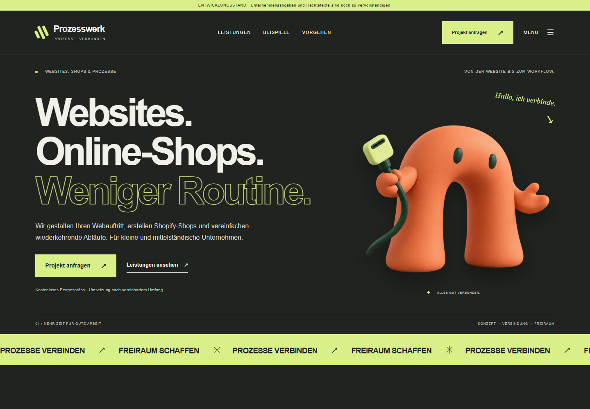
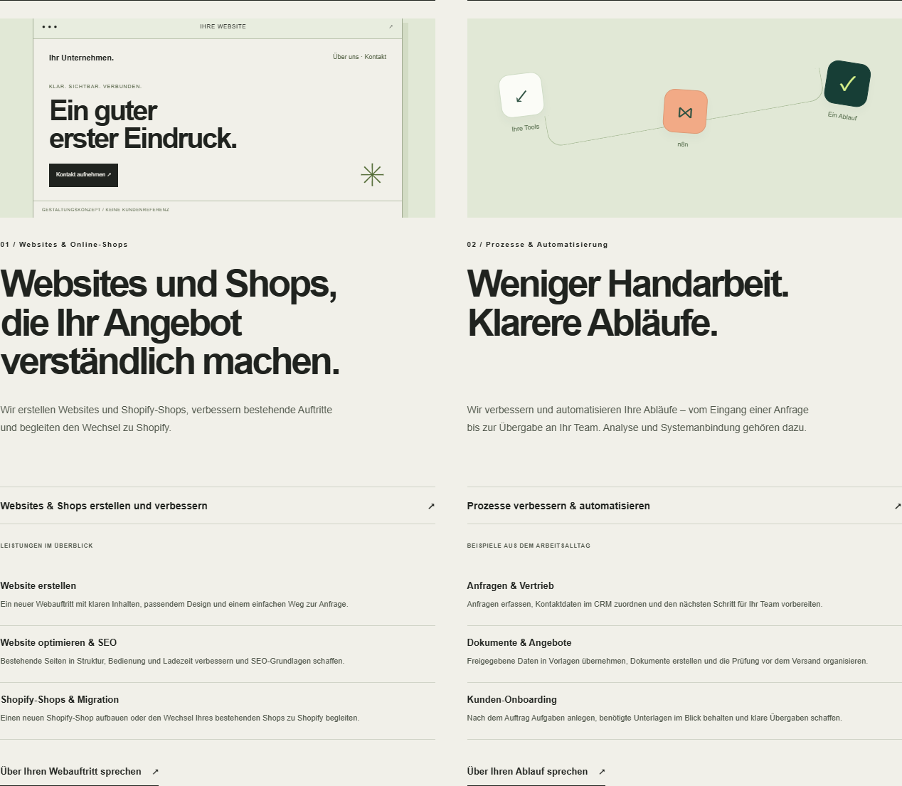
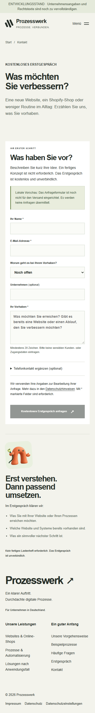

# Prozesswerk

**Responsive Unternehmenswebsite mit serverseitigem Anfrageformular und vorbereitetem Lead-Management.**

Ein KI-unterstütztes Portfolio- und Praxisprojekt mit Next.js, React und TypeScript. Es verbindet eine eigenständige visuelle Gestaltung mit nachvollziehbarer Formularverarbeitung, Tastaturbedienung und automatisierten Tests.



[Funktionen](#funktionen) · [Lokal starten](#lokal-starten) · [Architektur](docs/ARCHITECTURE.md) · [Tests](#qualität-und-tests) · [Projektstatus](#projektstatus)

## Ziel des Projekts

Eine übersichtliche Website für ein konzeptionelles Dienstleistungsangebot entwickeln: Websites und Shopify-Shops sowie Prozessoptimierung und Automatisierung. Besucher sollen Leistungen verstehen, Beispiele erkunden und eine Projektanfrage stellen können.

Die Website präsentiert diese Leistungen. Sie ist selbst **kein Shopify-Shop, keine Shopify-App und kein Werkzeug zur Shop-Migration**. Die gezeigten Anwendungsfälle sind Konzepte, keine behaupteten Kundenreferenzen.

## Funktionen

- Responsive Start-, Leistungs-, Beispiel-, Wissens- und Kontaktseiten.
- Einheitliche Darstellung der zwei Leistungsbereiche und ihrer Detailseiten.
- Interaktiver Prozess-Explorer und zurückhaltende Animationen mit Unterstützung für reduzierte Bewegung.
- Tastaturbedienbares Menü mit Fokussteuerung, Escape-Taste und gesperrtem Hintergrund.
- Anfrageformular mit drei Pflichtfeldern, serverseitiger Validierung und erhaltenen Eingaben bei Fehlern – auch ohne JavaScript.
- Individuelle Seitentitel, Metadaten, strukturierte Daten, Sitemap und Open-Graph-Bild; die Vorschau bleibt absichtlich auf `noindex`.
- Implementierte Backend-Bausteine für Leads, Admin-Zugang, CSV-Export und eine transaktionale Outbox. E-Mail und signierte Webhooks sind standardmäßig deaktiviert.

<details>
<summary>Weitere Screenshots</summary>

### Leistungen



### Mobile Kontaktseite



</details>

## Technischer Aufbau

| Bereich              | Umsetzung                                                    |
| -------------------- | ------------------------------------------------------------ |
| Anwendung            | Next.js 15 App Router, React 19, TypeScript im Strict-Modus  |
| Gestaltung           | Eigenes CSS, responsive Layouts, Next Image                  |
| Eingaben             | Server Actions und Zod                                       |
| Datenhaltung         | PostgreSQL und Prisma 6                                      |
| Zugriff              | Admin-Sitzungen, scrypt-Passwortprüfung                      |
| Verarbeitung         | Transaktionale Outbox, separater Worker, Wiederholungslogik  |
| Optionale Zustellung | Resend sowie HMAC-signierte Webhooks für einen n8n-Empfänger |
| Qualität             | TypeScript, ESLint, Node-Test-Runner, Playwright, axe-core   |

[Hinweise zur statischen Portfolio-Demo](docs/DEMO.md). Ein öffentlicher Demo-Link wird erst nach erfolgreicher Veröffentlichung ergänzt.

Die genauen Abhängigkeiten sind im [Lockfile](package-lock.json) festgehalten.

## Lokal starten

Voraussetzungen: Node.js 22 oder 24 und npm. PostgreSQL wird für die reine Seitenvorschau nicht benötigt.

1. Repository herunterladen oder klonen und im Projektordner öffnen.
2. Abhängigkeiten installieren:

   ```sh
   npm ci
   ```

3. `.env.example` nach `.env` kopieren. Die Beispielkonfiguration für die Seitenvorschau belassen: `FORM_SECRET` und `RATE_LIMIT_SECRET` leer, `DELIVERY_ENABLED=false`, `SITE_INDEXABLE=false`.
4. Entwicklungsserver starten:

   ```sh
   npm run dev
   ```

5. [Lokale Vorschau öffnen](http://localhost:3000).

Ohne Formularkonfiguration bleibt das Formular sichtbar deaktiviert. Das ist der erwartete Vorschaumodus. `localhost` und `127.0.0.1` sind unterschiedliche Origins: Browseradresse, `APP_ORIGIN` und `SITE_URL` müssen zusammenpassen.

### Anfrageverarbeitung aktivieren

Eine eigene lokale PostgreSQL-Datenbank anlegen und `DATABASE_URL` in `.env` eintragen. Zwei unabhängige Secrets erzeugen und als `FORM_SECRET` bzw. `RATE_LIMIT_SECRET` hinterlegen. Diesen Befehl zweimal ausführen:

```sh
node -e "console.log(require('crypto').randomBytes(32).toString('hex'))"
```

Anschließend Migrationen ausschließlich auf der dafür angelegten Datenbank anwenden und den Server neu starten:

```sh
npm run db:deploy
npm run dev
```

`DELIVERY_ENABLED=false` verhindert externe Zustellung, **nicht die Speicherung** von Anfragen. Für Tests ausschließlich synthetische Daten verwenden. Admin-Anlage, Worker und optionale Zustellung beschreibt die [Betriebsanleitung](docs/BETRIEB.md).

### Produktionsbuild lokal prüfen

```sh
npm run build
npm start
```

Docker-Dateien liegen bei; der Docker-Betrieb wurde im aktuellen Prüfstand nicht ausgeführt. Dies ist keine Freigabe für einen öffentlichen Produktivbetrieb.

## Qualität und Tests

```sh
npm run typecheck
npm run lint
npm test
```

Für die öffentlichen Browsertests einen Produktionsbuild ohne `FORM_SECRET` auf Port 3000 starten. Chromium installieren und in der Shell `TEST_BROWSER_CHANNEL=chromium` setzen; bei abweichender Adresse zusätzlich `TEST_BASE_URL` setzen.

```sh
npx playwright install chromium
npm run test:e2e -- tests/e2e/design.spec.ts tests/e2e/offering.spec.ts tests/e2e/studio.spec.ts tests/e2e/motion.spec.ts tests/e2e/master.spec.ts
```

Die [GitHub-Actions-Konfiguration](.github/workflows/ci.yml) führt diese öffentlichen Tests sowie Typprüfung, Lint, Unit-Tests und Build aus. Ein tatsächlicher GitHub-Lauf kann erst nach dem Upload bestätigt werden.

**Dokumentierter lokaler Prüfstand vom 19.10.2026:** 17 Browsertests und 10 Unit-/Sicherheitstests bestanden. Vier der 17 Browsertests prüfen Formularfehler auf einer separaten Fehlerinstanz auf Port 3101 und gehören deshalb nicht zum öffentlichen CI-Lauf. Details und Grenzen stehen im [Testprotokoll](docs/TESTPROTOKOLL-MASTER.md).

Eine einzelne mobile Lighthouse-Labormessung ergab Performance 99, Accessibility 100, Best Practices 100 und SEO 69. Der SEO-Wert ist durch die absichtlich nicht indexierbare Vorschau begrenzt. Diese Messung ist keine Garantie für Hosting, reale Geräte oder vollständige Barrierefreiheit.

Datenbank-Integrationstests und `site.spec.ts` benötigen eine dedizierte Testdatenbank und `ALLOW_DATABASE_TESTS=true`. Sie verändern Testdaten. Ein pauschales `npm run test:e2e` setzt außerdem die separate Formular-Fehlerinstanz voraus. Siehe [Testanleitung](docs/TESTING.md).

## Bewusste Entscheidungen

- **Serverseitige Validierung:** Die Prüfung hängt nicht allein vom Browser ab. Fehlermeldungen verweisen auf die betroffenen Felder und erhalten die Eingaben.
- **Transaktionale Outbox:** Speichern und Zustellen sind getrennt. Ein bestätigter Datenbankeintrag ist noch keine bestätigte E-Mail-Zustellung.
- **Zugängliche Bewegung:** Inhalte sind sofort lesbar; Animationen verzögern keine Navigation. Bewegte Laufschrift lässt sich pausieren.
- **Sicherer Vorschaumodus:** Ohne Konfiguration kein scheinbar funktionierender Versand, keine externen Zustellungen und keine Suchmaschinenindexierung.

## Projektstatus

| Bereich                                | Stand                                                                          |
| -------------------------------------- | ------------------------------------------------------------------------------ |
| Öffentliche Seiten und Navigation      | Lokal umgesetzt und automatisiert geprüft                                      |
| Formularvalidierung und Fehlerzustände | Lokal geprüft, einschließlich erhaltener Eingaben                              |
| Datenbank, Admin und Outbox            | Implementiert; aktuelle End-to-End-Prüfung mit echter Testdatenbank ausstehend |
| Externe E-Mail-/Webhook-Zustellung     | Vorbereitet, deaktiviert; tatsächlicher Empfang nicht bestätigt                |
| Öffentliche Live-Demo                  | Noch nicht veröffentlicht                                                      |
| Unternehmens- und Rechtstexte          | Entwürfe mit Platzhaltern                                                      |

Nächste Schritte: Datenbank-Integration erneut prüfen, Zustellung in einer isolierten Umgebung testen, manuelle Screenreader- und weitere Browserprüfungen durchführen und vor einem Livegang Betreiberangaben sowie Nutzungsrechte klären.

## Arbeitsweise und KI-Unterstützung

Das Projekt wurde mit umfangreicher Unterstützung von OpenAI Codex entwickelt. Konzept, Leistungsangebot, gestalterische Richtung und Überarbeitungen wurden im Dialog festgelegt. KI unterstützte wesentlich bei Quellcode, Texten, Dokumentation und Testautomatisierung; die Illustrationen wurden mit einem KI-Bildwerkzeug erzeugt.

Dieses Repository dokumentiert das entstandene Projekt und seine überprüften Eigenschaften. Es behauptet keine vollständig ohne Hilfsmittel erbrachte Eigenentwicklung. Die Weiterentwicklung dient auch dazu, Architektur, Code und Entscheidungen selbst nachzuvollziehen und erklären zu können.

## Dokumentation und Rechte

- [Architektur und Datenfluss](docs/ARCHITECTURE.md)
- [Tests ausführen und Prüfgrenzen verstehen](docs/TESTING.md)
- [Installation und Betrieb](docs/BETRIEB.md)
- [Aktueller ausführlicher Prüfbericht](docs/TESTPROTOKOLL-MASTER.md)
- [Beitragen](CONTRIBUTING.md) und [Sicherheitshinweise](SECURITY.md)
- [Herkunft und Nutzungsrechte](RIGHTS.md)

Es wurde noch keine eigene Open-Source-Lizenz vergeben. Abhängigkeiten behalten ihre jeweiligen Lizenzen. Die Sichtbarkeit eines Repositorys ersetzt keine Nutzungslizenz.

## Repository-Prüfung vom 23.10.2026

Der vollständige Projektstand wurde mit frisch installierten npm-Abhängigkeiten geprüft. Die automatische Prisma-Client-Erzeugung ist über `postinstall` hinterlegt. Typprüfung, Lint, 10 Unit-/Sicherheitstests, Produktionsbuild und 13 öffentliche Browsertests bestanden lokal. Die vier isolierten Formular-Fehlertests und Datenbank-Integrationstests wurden bei diesem Lauf nicht wiederholt. GitHub-Actions-Ergebnisse gelten jeweils für den dort geprüften Commit.

## Gestaltung mit Open Design

Die Gestaltung wurde anhand der Redesign- und Bewegungsleitfäden von Open Design überarbeitet. Quellen und Umsetzung: [Open-Design-Dokumentation](docs/OPEN-DESIGN.md). Farben, Typografie und Bedienregeln: [DESIGN.md](DESIGN.md).
