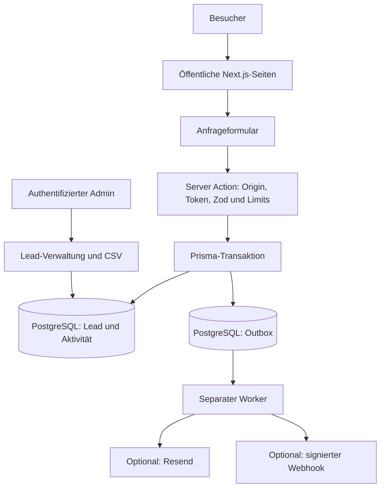

# Architektur

Aktueller Portfolio-Überblick. Ältere Entwurfsdokumente im Ordner `docs` dokumentieren teilweise frühere Inhalts- und Formularstände; für den aktuellen Umfang sind README und Testprotokoll maßgeblich.

## Komponenten und Datenfluss



Die reine Seitenvorschau benötigt keine funktionierende Datenbank. Anfrageverarbeitung und Admin-Funktionen benötigen sie. E-Mail und Webhooks bleiben bei `DELIVERY_ENABLED=false` ausgeschaltet.

## Projektstruktur

```text
src/app/                 Seiten, Server Actions und API-Routen
src/components/          Layouts, Navigation, Formular und Illustrationen
src/lib/                 Inhalte, Validierung, Authentifizierung und Zustellung
prisma/                  Datenmodell und Migrationen
scripts/                 Admin-Anlage, Worker und Betriebswerkzeuge
tests/                   Unit-, Integrations- und Browsertests
public/                  Lokale Bilder und Icons
examples/                Verifizierung eines Webhook-Empfängers
docs/                    Architektur, Betrieb, Prüfberichte und Screenshots
.github/                 CI, Issue- und Pull-Request-Vorlagen
```

## Wichtige Grenzen

Erfolgreiche Speicherung und externe Zustellung sind unterschiedliche Zustände. Eine stabile Ereigniskennung und Wiederholungen unterstützen zuverlässige Verarbeitung; eine garantierte Exactly-once-Zustellung über fremde Dienste wird nicht zugesichert. Der externe Empfänger muss Signatur, Zeitfenster und doppelte Ereignisse prüfen.

Der Admin-Bereich ist serverseitig geschützt. Formulartoken, Origin-Prüfung, Limits, Passwort-Hashes und CSV-Absicherung sind technische Maßnahmen; die Tests ersetzen keinen unabhängigen Sicherheitsaudit.

Das Dienstleistungsangebot ist Inhalt dieser Website. Shopify-Verwaltung, Migrationen fremder Shops und echte CRM-Workflows sind keine eingebauten Produktfunktionen dieses Repositorys.
